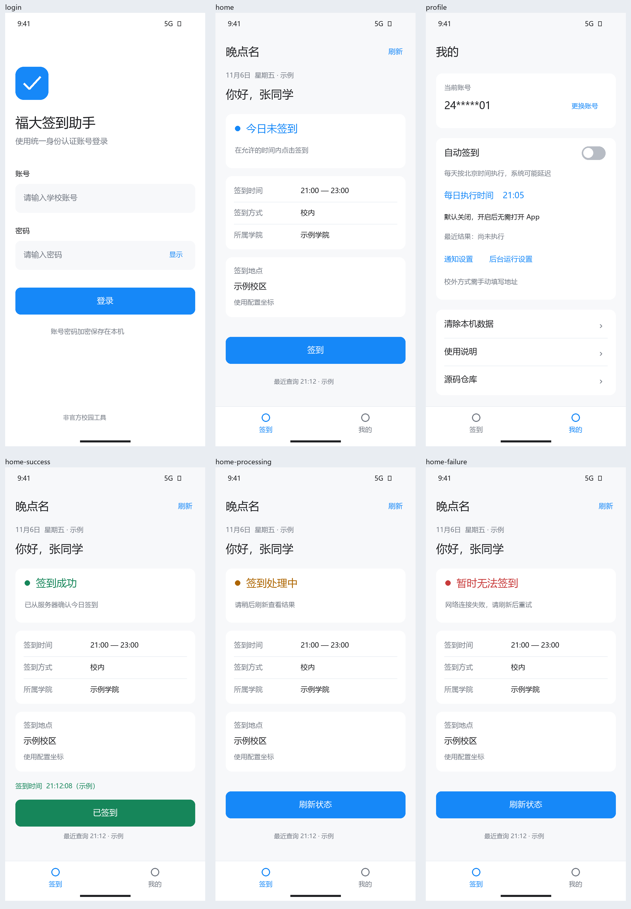

# 福大签到助手 · FZU-GPS

Android 原生晚点名工具，Kotlin + Jetpack Compose，Android 8.0 及以上。采用蓝白色调、简洁界面和独立图标，非学校官方客户端。

当前源码版本为 1.1.0，已发布的 GitHub Release 为 1.0.2；自动签到需要 1.1.0 构建包，1.0.2 不包含此功能。



## 使用

1. 从 [GitHub Releases 最新版本](https://github.com/DriOgon/FZU-GPS/releases/latest) 的 Assets 下载签名 APK 并安装，不需要在手机安装 Python，也不需要 Android Studio。
2. 输入自己的统一身份认证账号密码。凭据使用 Android Keystore 管理的密钥加密后保存在本机，不上传到额外服务器。
3. 默认手动签到：打开 App 查看当天计划，在允许的时间点击「签到」。打开、登录和刷新本身不会提交。
4. 以查询确认的结果为准。「处理中」「结果待确认」均不等于成功，请先刷新核实。

遇到验证码会停止，不提供绕过或自动识别。签到要求以学校规定为准。当前版本使用原脚本配置坐标，不读取设备 GPS；校内/校外方式由服务器决定，校外方式地址为空时不能提交。客户端不保证任何账号或地点均能签到成功。

「我的」可更换账号、清除本机数据和查看说明。每台手机只保存一个账号，Cookie 和 Token 仅存于内存。不申请定位或精确闹钟权限，不包含统计上报。

## 可选自动签到（1.1.0）

在「我的 → 自动签到」打开开关，选择每日时间并点击「保存设置」。默认时间是北京时间 21:05，默认开关关闭，升级不会自动开启。修改时间也需保存；保存时如果当天时间已过，从明天开始，不立即补签。账号必须已经成功加密保存在本机。

开启后无需打开 App；WorkManager 在系统允许时执行，可能因省电、后台限制或断网延迟，不能保证在截止前完成。请在系统应用设置中允许后台运行；强制停止后需重新打开 App。通知权限可拒绝，拒绝后仍运行，但无法收到结果通知，需在 App 内查看。通知设置和后台应用设置入口均在自动签到区域。

每次执行重新查询学校计划、方式、服务器时间和状态。只自动处理校内方式，沿用现有配置坐标；已签到则跳过，校外方式需打开 App 填写地址手动处理。设置时间必须位于学校允许时段。遇到验证码或认证失败会暂停，重新登录后需点击「恢复自动签到」。

提交前网络或服务暂时不可用时，最多尝试三次，间隔约 5、10 分钟，仍受系统调度影响。签到请求一旦可能发出，就持久记录并禁止自动重发；处理中和未知结果只查询确认，后续最多再查询两次。进程重启、重新登录、修改自动时间不会清除未确认记录。更换账号或清除本机数据会关闭自动功能并取消旧任务；已经发出的请求无法撤回。

本机数据库只保存设置、执行原因和防重记录，不保存密码、Token 或原始认证响应，且排除系统备份。清除本机数据或卸载会清除这些记录；再次登录后应先刷新学校状态核实。

代码结构、任务有效性与防重细节见 [自动签到实现说明](docs/automation.md)。

## 工程

```text
android-app/   Android 工程，含 Gradle Wrapper 和离线协议/界面测试
reference/     去掉个人账号密码的 Python 参考版
docs/          设计规范、预览与验证说明
tools/         构建、设计预览、协议测试数据和发布前检查脚本
```

## 构建

固定工具版本：JDK 17、Gradle 8.13、Android Gradle Plugin 8.11.1、Kotlin 2.1.21、compile/target SDK 36、Build Tools 35.0.0。首次构建需联网获取依赖。依赖版本固定在 Gradle 文件，Wrapper 配置校验 Gradle 分发包的 SHA-256。

可以用 Android Studio 打开 `android-app`，或安装 JDK 17 和 Android SDK、配置 `JAVA_HOME` 与 `ANDROID_HOME` 后使用命令行。工具也可放在项目内 `.tools/jdk17` 和 `.tools/sdk`；构建脚本优先使用这些位置，不改系统 Java。

Windows PowerShell：

中文工作目录下，脚本会临时映射一个空闲英文盘符供 Windows 构建工具使用，结束后撤销；不会移动工程文件，并会恢复调用前的进程环境变量。

```powershell
.\tools\build.ps1 -Task Check    # Debug APK、单元/UI 模拟测试、Lint
.\tools\build.ps1 -Task Debug    # 只构建 Debug APK
.\tools\build.ps1 -Task DeviceTest # 连接并授权手机后：隔离测试版的界面、截图及加密存储测试
.\tools\new-signing-key.ps1      # 首次生成自己的本地发布签名；已有签名时拒绝覆盖
.\tools\build.ps1 -Task Release  # 用本地签名构建 Release APK 并运行 Lint
```

其他平台：

```sh
cd android-app
./gradlew assembleDebug testDebugUnitTest lintDebug
```

APK 输出在 `android-app/app/build/outputs/apk/`。Release 签名配置为项目根目录 `.signing/release.properties`，内容包含 `storeFile`（相对 `.signing`）、`storePassword`、`keyAlias`、`keyPassword`。请妥善私下备份整个 `.signing`；更新安装必须沿用同一应用标识和签名。不要分享或上传私钥、签名配置、账号数据或排错页面。

如果只有系统代理可联网，需在个人 Gradle 配置中设置 Java 的 HTTP/HTTPS 代理；不要把本机代理配置提交到项目。

## 验证与发布

测试使用虚构账号、MockWebServer 和 Robolectric，不向学校提交签到。Python/Kotlin 加密对照数据可用 `python tools/generate_vectors.py` 生成（需 pycryptodome）；设计预览可用 `python tools/render_design.py` 生成（需 Pillow 和中文字体）。预览是设计稿。真实组件截图由手机上的独立测试版生成，优先通过测试框架的 `additionalTestOutputDir` 导出到构建输出目录，不包含真实账号。Debug 包名带 `.debug`，与正式版隔离。

提交前运行 `python tools/check_secrets.py`。原始脚本、个人配置、工具缓存、签名和 APK 全部排除 Git；只提交脱敏参考版。实测结果与尚未完成的真机验收见 [验证记录](docs/verification.md)。

学校接口和页面可能变化。登录失败请先检查凭据；验证码请稍后重试；提交超时请刷新核实。本项目不自动重发已经可能发送的签到请求。

## 1.0.1 更新（2026-11-07）

修复学校返回 `21:00      ` 等带空格时间时被误判为“当前不在签到时间内”的问题。解析时兼容字段空格，页面显示去掉首尾空格，提交仍保留学校原始时间参数。沿用原签名，可从 1.0.0 直接覆盖升级并保留账号。

## 1.0.2 更新（2026-11-07）

统一 App、文档和预览图中的说明文字。沿用原发布签名，支持覆盖升级并保留账号。

## 1.1.0 更新

增加可选的每日后台自动签到、可修改时间、结果通知和暂停恢复。手动与自动操作共用签到入口，提交防重记录持久保存。沿用原发布签名和包名，升级保留账号，自动签到默认关闭。
